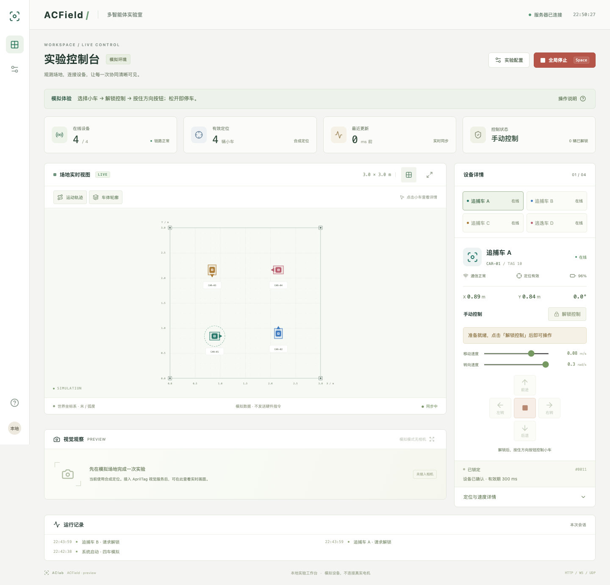

<p align="center"></p>
<h1 align="center">ACField</h1>
<p align="center"><strong>An Open Multi-Robot Testbed for Multi-Agent Control</strong></p>
<p align="center">From shared infrastructure to independent ideas.<br />Developed and maintained by <strong>AClab · Algorithms and Collaboration Lab</strong>.</p>
<p align="center"><a href="https://yaoqih.github.io/acfield/">Documentation</a> · <a href="README.zh-CN.md">中文介绍</a> · <a href="https://yaoqih.github.io/acfield/design/philosophy">Design philosophy</a> · <a href="https://github.com/yaoqih/acfield/issues">Issues</a></p>
<p align="center"><a href="https://github.com/yaoqih/acfield/actions/workflows/ci.yml"></a> <a href="https://github.com/yaoqih/acfield/actions/workflows/docs.yml"></a> <a href="LICENSE"></a></p>

ACField provides an inspectable path from localization to multi-robot velocity execution. The reference setup uses four small differential-drive robots, external AprilTag localization and a local computer. Connect your own controller through a shared state and joint-action interface; inspect execution feedback and stop reasons through the console and logs.

> **Development preview.** The repository includes working software, automated checks and a V11 reference mechanical design. Physical assembly, calibration, wireless timing and stopping performance still require measurement. The demo is an interface tool, not a validated training simulator or benchmark. See [capabilities and evidence](https://yaoqih.github.io/acfield/guide/status).

## Start without robots

Requirements: Python 3.11+ (3.12 recommended), Node.js 20.19+ or 22.12+, Git and [uv](https://docs.astral.sh/uv/). See the [quick start](https://yaoqih.github.io/acfield/guide/quickstart) for a pip/venv alternative.

```bash
git clone https://github.com/yaoqih/acfield.git
cd acfield
uv sync --python 3.12 --extra test
npm --prefix robot_server/frontend ci
npm --prefix robot_server/frontend run build
cd robot_server
./run.sh
```

Open **http://127.0.0.1:8000**. Default demo mode does not open the device UDP transport. Select a robot, explicitly arm it and hold a direction button. Global stop locks the fleet; releasing it does not re-arm the robots.

With the server still running, execute a bounded example from the repository root:

```bash
.venv/bin/python examples/velocity_control.py --duration 2
```

## What is included

| Component | Purpose | Entry |
| --- | --- | --- |
| Local runtime and console | State, control ownership, joint velocity validation, protective stops | [robot_server](robot_server/README.md) |
| AprilTag localization | Camera inputs, world calibration, provenance and age reporting | [Localization guide](https://yaoqih.github.io/acfield/guide/localization) |
| ESP32 firmware | Wheel-speed control, finite command lifetimes, arming and fault handling | [Firmware](esp32_software/firmware/README.md) |
| Reference hardware | Two-part V11 chassis, editable sources and nominal geometry reports | [Hardware](hardware_design/README.md) |
| Python SDK | Independently installable typed client, joint actions and scoped ownership | [SDK](sdk/python/README.md) |
| Examples and recording | Bounded SDK control example and JSONL event recording | [Examples](examples/README.md) |
| Design documentation | Rationale, tradeoffs, research validity and a staged roadmap | [Design](https://yaoqih.github.io/acfield/design/philosophy) |

<p align="center"></p>

## How the platform fits together

```text
Camera → AprilTag service → Control server → Wi-Fi / UDP → ESP32 → Motors
                                  ↑                          │
                         Controller / Web console            └─ Telemetry
                                  └─ Configuration and JSONL events
```

The platform owns state, command validation, execution feedback, fault stops and basic recording. Your experiment defines the policy, observations, task, training and evaluation. Shared infrastructure can support decentralized policies when observation and communication rules are explicitly enforced by the experiment layer.

Distances use metres; angles use radians, counterclockwise positive. The differential-drive control point is the axle midpoint. Batch validation uses the same candidate state, while network and motor execution still have timing skew. One request does not imply hardware synchronization.

## Why these choices

- **A small, understandable system.** One owner of runtime state and independent device-side command expiry make failure behavior easier to inspect.
- **Visible assumptions.** Calibration, timing, coordinate frames and protective intervention are experimental conditions worth reporting.
- **A reusable common layer.** The core stays independent of training frameworks. Paper-specific experiments pin a platform commit in separate repositories.
- **Evidence before claims.** Software checks, nominal geometry and physical measurements are reported separately.

Read the [design philosophy](https://yaoqih.github.io/acfield/design/philosophy), [architecture](https://yaoqih.github.io/acfield/design/architecture) and [decision record](https://yaoqih.github.io/acfield/design/decisions).

## Real hardware

Start with the [reference hardware](https://yaoqih.github.io/acfield/hardware/overview), [bring-up](https://yaoqih.github.io/acfield/hardware/bringup) and [localization](https://yaoqih.github.io/acfield/guide/localization) guides. The current firmware deliberately disables motor output until measured encoder parameters and configuration are supplied. Use one validated vehicle before replicating the fleet.

The runtime is intended for a local computer or trusted experiment LAN. The public documentation site is static and does not control robots. See [configuration](https://yaoqih.github.io/acfield/guide/configuration) for operating boundaries.

## Development and docs

```bash
# Documentation, from the repository root
npm ci
npm run docs:dev
npm run docs:build

# Backend, inside robot_server/
uv run --python 3.12 --extra test pytest -q
```

CI checks the backend, actual firmware parser contract, Python SDK on Python 3.11–3.13, localization, frontend types/build and four firmware environments. Contract tests require a host C++ compiler and PlatformIO-installed ArduinoJson; see [CONTRIBUTING.md](CONTRIBUTING.md).

Documentation is built and deployed through [GitHub Actions](.github/workflows/docs.yml). Configure Pages to use **GitHub Actions**; subsequent main commits publish automatically. PRs build without deploying. See the [deployment guide](https://yaoqih.github.io/acfield/community/documentation).

## Roadmap, contribution and citation

The first Python SDK is available with typed state, joint actions and managed control sessions; see the [SDK guide](https://yaoqih.github.io/acfield/guide/python-sdk). Next milestones are measured reference hardware, SDK stability across external experiments and one complete physical example. Fixed-step simulation, tasks and episode/evaluation tooling follow concrete research needs. See the [roadmap](https://yaoqih.github.io/acfield/community/roadmap).

Questions, reproducibility reports and contributions are welcome in Chinese or English. Cite this repository and the commit or release used; GitHub provides a citation through [CITATION.cff](CITATION.cff). No paper or DOI is currently claimed.

Original code, documentation and reference design files use [Apache-2.0](LICENSE). Third-party assets retain their licenses; see [THIRD_PARTY_NOTICES.md](THIRD_PARTY_NOTICES.md).
