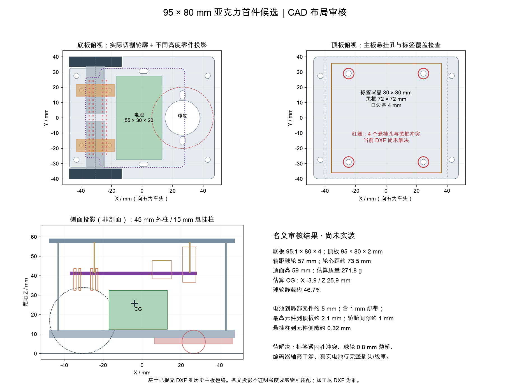
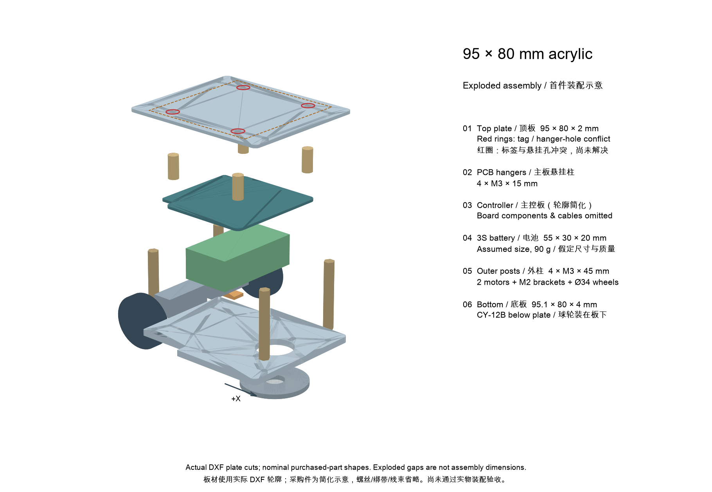

# 95 × 80 mm 亚克力小车：首件候选

此方案用于 3 × 3 m 多智能体围堵实验，采用双轮差速和前方 CY-12B 支撑球轮。它是名义设计，尚未完成真实零件试装、力学验证、相机识别及实车验收。先制作一辆并测量，再决定复制四辆。V11 130 mm 打印方案保留在 `../print_v11`。

[尺寸孔位、装配与动力详细解释](dimensions.md) · [每车 / 四车 BOM](bom.csv) · [机器可读审核结果](audit_results.json) · [可复现审核脚本](review.py)

## 本版图示

两图均已按本目录 95 mm 版本重画。板材使用 DXF 实际切割轮廓；爆炸图中的主板、电机、电池和球轮为简化采购件，展开间距不表示装配尺寸。旧版 V11 爆炸图仍在网站历史参考部分，不能拿来装配本车。

## 加工和标签文件

- [底板 DXF](bottom_plate_95.1x80_flat_4mm.dxf)：95.1 × 80 mm，4 mm 亚克力。
- [顶板 DXF](top_plate_95x80_flat_2mm.dxf)：95 × 80 mm，2 mm 亚克力。
- [两张图纸压缩包](95x80_flat_cutting_dxf.zip)：毫米单位、1:1 导入，全部轮廓切穿。底板前端 0.1 mm 是球轮法兰支撑设计，不是排版误差。
- [布局审核图](audit_layout.png)：仅供审阅，不是加工文件。
- [爆炸图](exploded.png)：45 mm 外柱、15 mm 悬挂柱与板下球轮的分层关系。
- 同名 SVG 保留可编辑轮廓来源；交付加工仍使用上面的 DXF ZIP，避免把说明图或两个格式重复导入切割任务。
- [12 张车顶标签 PNG](tag_images/tag36h11_80mm_white4_12ids_png.zip)：tag36h11，ID 10–21。成品 80 × 80 mm，黑框 72 mm，四周白边各 4 mm，不含出血，100% 实际大小打印。图案上边朝车头。现有车辆使用 ID 10–13，重复 ID 不可同时用于不同车。

注意：80 mm 贴纸覆盖四个内侧主板安装孔，螺丝头、孔洞或变形不能遮挡黑框和编码图案。现有 DXF 尚未解决贴纸与紧固件的冲突，需在首件试装中确定平整安装方式；不得据此直接批量加工。外侧安装孔也需检查螺丝头是否侵入白边。

## 主要结构和运动学

| 项目 | 名义参数与条件 |
| --- | --- |
| 电机 | 2 × 驰海 CHR-GM12-N20ABHL，A12、12 V、1:20、双相编码器及原配支架；首对试验候选 |
| 轮与支撑 | 2 × 34 mm 外径驱动轮，1 × CY-12B 球轮；轮轴中点作为差速/unicycle 控制点 |
| 尺寸 | 顶板 95 × 80 × 2 mm；底板 95.1 × 80 × 4 mm；整车实际包络含轮、线束、紧固件，需实测 |
| 电池空间 | 暂按 55 × 30 × 20 mm 本体平放；电池质量暂按 90 g，非已确认型号或容量 |
| 柱 | 外侧 M3 双通尼龙柱 45 mm × 4；主板悬挂柱 15 mm × 4；均需核实有效螺纹深度 |
| 紧固 | 电机支架 M2（原配螺钉，长度实测）；球轮 M3；其余按 M3；球轮 M3×10 为试装候选，配螺母并核对长度 |
| 轮间距 | 图纸名义轮心距约 73.5 mm；以实测有效轮径和轮距标定 |
| 位置 | 主动轴相对顶板中心 X = -30.5 mm，球轮中心 X = +26.5 mm；标签居中时驱动轴位于标签后方约 30.5 mm |
| 高度和质量 | 顶面离地约 59 mm；总质量约 272 g、重心高度约 25.9 mm，均为条件模型估算，不是实物测量 |

X 正方向为车头。车顶相对轮轴的位移、标签航向、轮距和整车包络均应实测后配置；不能将标签中心当成驱动轴控制点。差速模型是假设近似，球轮阻力、轮胎打滑和回差需要实验测量。

## 动力和采购

用户提供的 12 V 1:20 电机数据：空载 1100 rpm、额定 500 rpm、额定扭矩 14.7 mN·m、额定电流不超过 0.22 A、堵转电流约 0.4 A（单台）。按 34 mm 轮径换算，额定速度约 0.89 m/s、空载速度约 1.96 m/s；两台额定扭矩对应轮缘合力约 1.73 N。均为名义计算，实际速度、抓地及温升未验证；堵转电流不是持续工作电流。建议先买两台测试。1:30 可作为备选，额定点约 0.68 m/s。

每辆车基本采购：控制板 × 1、电机带支架 × 2、34 mm D 轴轮 × 2、CY-12B × 1、适配的 3S 电池 × 1、M3 双通柱 45 mm 和 15 mm 各 × 4、M3 紧固件及球轮螺母、电机支架 M2 紧固件、电池软垫/柔性绑带、匹配的电源及编码器线束。电池尺寸、电流、接头、重量、充电方式和线材针序须以实物确认；不要把先前较大的 2000 mAh 电池视为已适配此电池空间。充电器、电源适配器、路由器、相机和电脑按共用设备准备。

3S 锂电满充约 12.6 V，接近控制板标称 13 V 上限；应按实际板卡核对允许输入、极性、保险、开关、充电接口和电机驱动电流及瞬态。编码器插头的型号相同不代表针序相同，必须测量确认。

旧购物清单中的 **M3×50 / M3×25** 柱属于更高的历史布局，不是这版的 45 / 15 mm。M3×8 盘头螺丝主体用量每车 16 颗，球轮另需 2 颗螺钉、2 颗 M3 螺母；不强行把球轮也统一成 M3×8，需按法兰、板厚与 2.5 mm 螺母核算。详细数量及候选长度见 [BOM](bom.csv)。尼龙件可以用于本车轻载装配，但要检查螺纹啮合、松动和亚克力夹紧面；标签顶面紧固方式尚未定案。

动力上，1:20 比 1:100 额定点速度高约 3.85 倍，是否够扭矩应由真实起步、转弯、低电量和温升测试决定。[详细说明](dimensions.md)列出 1:20–1:150 对比、载荷和重心计算，以及为什么车轴后移仍要补偿标签偏移。

## 首件核对和调试

1. 纸样与实物核对 1:20 电机和支架尺寸、孔距、轴、编码器插座及离地高度。若轴距底板上表面 5 mm 而编码器同心直径 12 mm，则可能与底板干涉约 1 mm；图纸未开电机槽。
2. 实测球轮外形、孔距和工作高度；球轮孔与槽之间名义材料桥仅约 0.8 mm，需验证强度并检查 M3 螺钉及螺母装配。核对电池实际外形、出线、绑带及轮胎空间。
3. 核对主板背面针脚、元件与电池/绑带；按名义模型电池顶部与局部元件间隙约 5 mm，主板上方最高元件与顶板约 2.1 mm，插头和弯线未计入。解决顶板标签与紧固件冲突。
4. 校验左右电机和编码器方向、按固件计数方式测量每圈计数，确认轮距、轮径及控制点偏移。先架空，再从 0.2 m/s 落地逐步加速，测速度闭环、球轮、温升、电流、停止距离及网络/相机延迟。
5. 控制台和视觉服务使用实测标签黑框尺寸，名义为 `0.072 m`；标签高度和偏移装车后实测。场地标签按实际版本分别设置。仓库现有视觉配置和 V11 文件未自动切换；保存的运行配置可能覆盖初始配置。
6. 检查 4 mm 白边在实际相机高度、视角、全场范围和运动模糊下是否稳定识别，验证遮挡与丢帧停车，再逐步扩展到四车。
